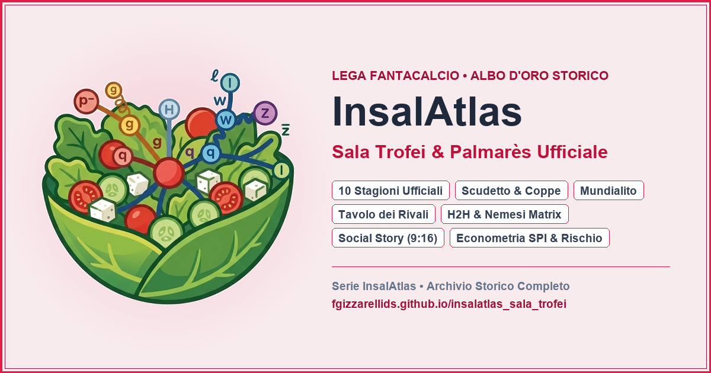

# InsalAtlas • Sala Trofei & Analytics Hub

[](https://github.com/fgizzarelliDS/insalatlas_sala_trofei/actions/workflows/deploy.yml)
[](https://github.com/fgizzarelliDS/insalatlas_sala_trofei/actions/workflows/ci.yml)
[](package.json)
[](https://www.typescriptlang.org/)
[](LICENSE)




> Albo d'oro interattivo, motore league-agnostic, analisi econometrica di competitività, dinamica storica, record all-time, H2H, Tavolo dei Rivali (fino a 6 manager), export Social Story 9:16 e schede manager per leghe Fantacalcio.

---

## Panoramica

**InsalAtlas Sala Trofei** evolve il classico albo d'oro statico in un hub storico e di analisi per leghe Fantacalcio.

L'applicazione offre un'interfaccia interattiva per desktop e mobile:

- **Dynamic N-Competitions Engine**: Architettura data-driven unificata (`src/config.ts`) con supporto per $N$ tornei e disonori arbitrari basati su 5 archetipi (`tier3`, `tier2`, `single`, `dishonor`, `banners`), pesi di punteggio personalizzabili, griglia CSS reattiva auto-sincronizzante, ordinamenti dinamici e modali albo d'oro con zero duplicazione di codice.
- **Dynamic Elo Rating Engine & Previsioni Partita**: Sistema di rating dinamico a doppia traccia (*⚡ Elo Puro* da baseline 1500 vs *🏛️ Elo Storico* calibrato sul Silverware Prestige Index SPI), aggiornato match-by-match con logistica standard a fattore $K \in \{24, 32\}$, transizione inter-stagionale con mean reversion (75/25), previsioni di probabilità pre-partita $P(\text{Win})$, traiettorie multi-squadra SVG interattive, ordinamento dinamico completo e toggle integrato nelle classifiche reale e merito.
- **In-Progress Form Index, Schedule Luck & Live Analytics**: Motore di analisi in tempo reale per la stagione in corso con calcolo deterministico giornata per giornata di forma recente (L5), Indice di Momentum pesato $\in [0, 1]$, Fortuna di Calendario ($\Delta\text{Luck}$), badge di stato compositi (🔥/📈/⚖️/📉/🧊), tabella responsive a 11 colonne con fallback aggraziato e modale per visualizzare il tabellino partita per partita di ciascuna squadra.
- **Architettura League-Agnostic**: Configurazione centralizzata (`src/config.ts`), colonne del tabellone dinamiche con griglia CSS reattiva, isolamento multi-tenant in local storage e supporto chiavi in mano per leghe arbitrarie.
- **Albo d'Oro Storico Decennale**: Bacheca trofei consolidata, rating storico e schede manager ad alta risoluzione (HD) condivisibili.
- **Bacheca Record Storici (Hall of Fame & Primati)**: **28 record certificati** su 5 categorie storiche (Punti & Podi, Dominio & Coppe, Rivalità H2H, Strisce & Fedeltà, Disonori & Curiosità) con navigazione contestuale duale (scheda manager e archivio classifica di stagione), inclusi i 3 record per debuttanti e matricole, gestione ex-aequo ed export Poster Panoramico HD + Story 9:16.
- **Head-to-Head (H2H), Tavolo dei Rivali (6 Manager) & Matrice Nemesi**:
  - *Duello 1vs1*: **Radar - 6 Assi**, barre duello a specchio e tabellino annate.
  - *Tavolo dei Rivali (Multi-Manager)*: confronto fino a **6 manager contemporanei** con multi-radar cromatico, mini-torneo incrociato a punti o PPG (con switch Contemporanee/Tutte) e tabella comparativa a colonne parallele (ottimizzata mobile con colonna metrica fissa e zero scroll su desktop).
  - *Matrice Nemesi N×N*: mappa globale delle bestie nere e vittime preferite con filtri di confidenza.
- **Social Story Engine (9:16 HD)**: Generazione istantanea di schede verticali 1080×1920 con safe-zone Instagram & WhatsApp per Profilo Manager, Duello H2H, Tavolo dei Rivali, singolo Record Storico (con stemmi e medaglie nel Podio Storico) e Top Primati Marquee Poster.
- **Archivio Stagioni & Classifiche Live**: Consultazione cronologica delle singole annate con classifiche ufficiali, finaliste delle coppe e vista Live Standings con colonna Elo integrata (Reale e Merito con toggle header).
- **Hub Analitico a 5 Tab**: Analisi longitudinale ed econometrica avanzata: Macro-Equilibrio, Cinismo GCI, Archetipi di Rischio, Dinamica Storica decennale e il nuovo **Motore Dinamico Elo Rating** (traiettorie multi-squadra SVG, previsioni pre-match, classifica dinamica ordinabile desktop/mobile e guida interattiva).
- **Gestione Stagioni In Corso & Debuttanti**: Isolamento delle annate attive dalle valutazioni consolidate di carriera per non penalizzare l'efficienza dei veterani e gestione asintotica dei debuttanti.
- **Vector Crest**: Catalogo di stemmi vettoriali ad alta definizione (`public/assets/crests/`) per rappresentare ogni squadra priva di logo personalizzato.
- **Econometria & Rischio**: Motore di analisi competitiva basato su teoria economica e modellazione del rischio.
- **Live Application**: [fgizzarellids.github.io/insalatlas_sala_trofei](https://fgizzarellids.github.io/insalatlas_sala_trofei/)
- **Database Ufficiale**: `public/data.json`

---

## Documentazione Tecnica Modulare

La documentazione del progetto è suddivisa in guide tematiche dedicate in [`docs/`](docs/):

### 1. [Architettura & Invarianti Tecniche](docs/01-architecture-invariants.md)

Struttura a **colonne native** (`.albo-grid-row`), il motore di theming basato su Custom Properties CSS (Gala, Serie A, Gazzetta, Studio) e la pipeline di build con Vite.

### 2. [Funzionalità & Esperienza Utente](docs/02-features-and-ui.md)

Guida ai moduli applicativi: albo d'oro interattivo con ordinamento multi-criterio, archivio cronologico delle stagioni e coppe, Hub Analitico a 5 Tab (incluso il motore Dinamico Elo Rating con classifiche e traiettorie SVG), dinamica storica a doppia prospettiva (Manager vs. Stagioni), motore di fallback per stemmi vettoriali (`src/crests.ts`), rendering off-screen nativo in HD tramite `html-to-image`, copia istantanea negli appunti, condivisione WhatsApp e modalità modifica.

### 3. [Econometria, Cinismo & Modelli di Rischio](docs/03-analytics-and-econometrics.md)

Approfondimento matematico del modulo analitico:

- **Silverware Prestige Index (SPI)**: Ponderazione asimmetrica per difficoltà di torneo.
- **Macro-Parità di Lega**: Indici di Gini bivariati ($G_{\text{prestige}}$, $G_{\text{rating}}$), Concentrazione Top-3 ($CR_3$), Herfindahl-Hirschman Index ($\text{HHI}$) e Normalized Relative Entropy ($H_{\text{rel}}$).
- **Cinismo & Podi**: Frequenza podio ($PR$), Killer Instinct ($KI$) e Finals Conversion Rate.
- **Modellazione di Coda (Tail Risk)**: Feast-or-Famine Bayesiano ($\widetilde{FF}$), Net Tail Skew ($NTS$) e indice unificato Net Tail Index ($NTI$).
- **Tassonomia degli Archetipi**: Waterfall deterministico per la classificazione comportamentale dei manager.
- **Dinamica Storica, Stagioni In Corso & Debuttanti**: Metriche di baricentro, oscillazione posizioni ($\sigma_{\text{rank}}$), parità stagionale e neutralizzazione delle annate non concluse.
- **Motore Dinamico Elo Rating**: Curva logistica di vittoria attesa ($E_A$), K-factors ponderati per torneo, architettura Dual-Track (*Puro* vs *Storico* calibrato su SPI) e carryover inter-stagionale con mean reversion al 25%.

### 4. [Data Schema & Validazione CI/CD](docs/04-data-schema-and-ci.md)

Specifiche del contratto dati `public/data.json`, pipeline di compilazione (`scripts/build_data.py`), validazione CI/CD (`scripts/validate.py`) e GitHub Actions.

### 5. [Guida: Aggiungere una Nuova Competizione (Registry Dinamico)](docs/05-adding-competitions-guide.md)

Guida operativa passo-passo per estendere l'albo d'oro con nuove competizioni tramite `COMPETITION_REGISTRY`: i 5 archetipi, le icone SVG vettoriali, la griglia CSS responsive e l'adattamento automatico di classifiche, modali ed export HD.

---

## Quick Start (Sviluppo Locale)

```bash
# 1. Clona il repository
git clone https://github.com/fgizzarellids/insalatlas_sala_trofei.git
cd insalatlas_sala_trofei

# 2. Installa le dipendenze
npm install

# 3. Compila e valida il database JSON
npm run build:data     # compila da sorgenti raw a public/data.json
npm run validate:data  # valida la conformità allo schema JSON

# 4. Esegui la suite di test unitari
npm run test

# 5. Avvia il server di sviluppo locale
npm run dev

# 6. Type-checking TypeScript e build di produzione
npm run type-check
npm run build

# oppure per preview del bundle di produzione in locale
npm run preview --host
```
